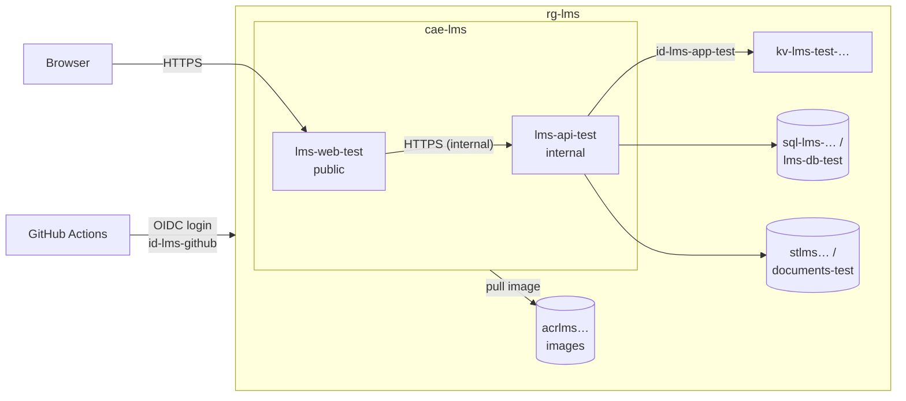

# Azure setup

How the Azure environments for Lexicon LMS are created, deployed and removed.

Everything is created with Bicep and GitHub Actions. The subscription owner runs one script once, and after that the pipelines do the rest. Manual setup in the Azure portal is described in [Appendix A](#appendix-a-manual-setup-in-the-portal), for reference.

## Contents

1. [Overview](#1-overview)
2. [Prerequisites](#2-prerequisites)
3. [One-time setup](#3-one-time-setup)
4. [First deployment](#4-first-deployment)
5. [Day-to-day work](#5-day-to-day-work)
6. [Secrets and variables](#6-secrets-and-variables)
7. [Moving to another subscription](#7-moving-to-another-subscription)
8. [Tearing down](#8-tearing-down)
9. [Troubleshooting](#9-troubleshooting)
- [Appendix A: Manual setup in the portal](#appendix-a-manual-setup-in-the-portal)
- [Appendix B: Files](#appendix-b-files)

---

## 1. Overview



The prod environment has the same resources with `prod` instead of `test`. The SQL server, storage account, registry and Container Apps environment are shared by both environments.

### What creates what

| Created by | Runs | Resources |
|---|---|---|
| `infra/bootstrap.bicep` | Once per subscription, by the owner, with `infra/bootstrap.cmd` | Resource group `rg-lms`, identities, container registry, Key Vaults, all role assignments |
| `infra/shared.bicep` | `infra.yml` | Log Analytics `log-lms`, Container Apps environment `cae-lms`, SQL server `sql-lms-…`, storage account `stlms…` |
| `infra/environment.bicep` | `infra.yml`, once per environment | Database `lms-db-<env>`, blob container `documents-<env>`, Key Vault secrets, container apps `lms-api-<env>` and `lms-web-<env>` |
| `.github/workflows/deploy.yml` | Every merge to `Dev` and `master` | New images in the registry, new revision of both container apps |

`…` is an 8-character suffix that Bicep calculates from the subscription and resource group, for example `trln2saa`. It makes the global names unique and is the same every time the files are deployed to the same resource group.

### Monthly cost (approximate)

| Resource | Cost |
|---|---|
| SQL database, Basic, per environment | about 5 USD |
| Container registry, Basic | about 5 USD |
| Container apps (scale to zero, 0.25 CPU) | mostly covered by the monthly free grant |
| Log Analytics, storage, Key Vault | a few cents to a few USD, depending on use |

With only test running, expect roughly 10–15 USD per month. Prod adds about 5 USD for its database.

---

## 2. Prerequisites

| What | Why |
|---|---|
| **Owner** of the Azure subscription | Bootstrap creates role assignments, which only an owner can do |
| **Admin** of the GitHub repository | Bootstrap sets repository and environment secrets |
| Windows with `winget` | Bootstrap installs the Azure CLI and GitHub CLI with winget |
| GitHub environments `test` and `prod` | Must exist before bootstrap, see [3.1](#31-github-environments) |

Everything else (Azure CLI, Bicep, GitHub CLI, resource providers) is installed or registered by the bootstrap script.

---

## 3. One-time setup

### 3.1 GitHub environments

Only needed once for the repository. The environments stay when moving to another subscription.

**Settings → Environments → New environment**

| Environment | Deployment branches and tags |
|---|---|
| `test` | Selected branches: `Dev` |
| `prod` | Selected branches: `master` |

The branch rules are part of the security model: Azure only trusts GitHub logins from these environments, and the environments can only be used from these branches.

### 3.2 Bootstrap

Double-click **`infra/bootstrap.cmd`**, or run from the repository root:

```powershell
powershell -ExecutionPolicy Bypass -File .\infra\bootstrap.ps1
```

The script:

1. Installs the Azure CLI, Bicep and GitHub CLI if they are missing.
2. Logs in to Azure and asks you to confirm the subscription. Use **t** to log in to another directory (tenant).
3. Logs in to GitHub and reads the repository's ids.
4. Registers the resource providers the project uses.
5. Deploys `infra/bootstrap.bicep`.
6. Sets the GitHub secrets and variable. You are asked for the password of the seeded users in `test` and `prod`. **Save it in a password manager and share it with the team.** It cannot be read from GitHub later.

The script is safe to run again. Existing passwords are never changed.

### 3.3 Ruleset for Dev and master

**Settings → Rules → Rulesets**, for both `Dev` and `master`:

- Require a pull request before merging
- Require status checks to pass: **`Build and test`** (source: GitHub Actions)
- Require branches to be up to date before merging

Do not add `Tests before deploy / Build and test`. That check only runs after a merge, so pull requests would wait for it forever.

---

## 4. First deployment

After bootstrap in a new subscription, the registry is empty and no apps exist.

1. **Actions → Infrastructure → Run workflow** on `Dev`.
   Creates the shared resources and the test environment. The apps start with Microsoft's quickstart image, since our images do not exist yet.
2. **Actions → Deploy → Run workflow** on `Dev`.
   Runs the tests, builds and pushes the images, deploys them and sets port 8080.
3. Open the web app. The address is shown by:

   ```powershell
   az containerapp show --name lms-web-test --resource-group rg-lms --query properties.configuration.ingress.fqdn --output tsv
   ```

4. Log in as `anna.andersson@lms.com` (student) or `admin@lms.com` (teacher) with the seed password.

The API applies database migrations and seeds the users the first time it starts, so the first request can take up to a minute.

Prod is created the same way the first time `Dev` is merged into `master`, or with **Run workflow** on `master`.

---

## 5. Day-to-day work

| Event | What runs |
|---|---|
| Pull request to `Dev` or `master` | `ci.yml`: build and test. Required before merge. |
| Merge to `Dev` | `deploy.yml`: tests, build images, deploy to **test** |
| Merge to `Dev` that changes `infra/` | `infra.yml` deploys the Bicep files to **test**, and `deploy.yml` deploys the code |
| Merge `Dev` into `master` at the end of a sprint | The same, but to **prod** |
| Run workflow | Runs Infrastructure or Deploy on demand, on `Dev` (test) or `master` (prod) |

`infra.yml` and `deploy.yml` never run at the same time for the same environment.

---

## 6. Secrets and variables

All values are set by `infra/bootstrap.ps1`.

| Name | Type | Value | Used by |
|---|---|---|---|
| `AZURE_CLIENT_ID` | Repository secret | Client id of `id-lms-github` | `infra.yml`, `deploy.yml` (Azure login) |
| `AZURE_TENANT_ID` | Repository secret | Directory (tenant) id | `infra.yml`, `deploy.yml` (Azure login) |
| `AZURE_SUBSCRIPTION_ID` | Repository secret | Subscription id | `infra.yml`, `deploy.yml` (Azure login) |
| `SQL_ADMIN_PASSWORD` | Repository secret | Random, generated once | `infra.yml` → SQL server and connection strings |
| `JWT_SECRET_KEY` | Environment secret (`test`, `prod`) | Random, 64 characters, generated once | `infra.yml` → Key Vault → API |
| `SEED_PASSWORD` | Environment secret (`test`, `prod`) | Entered by the person running bootstrap | `infra.yml` → Key Vault → API (seeded users) |
| `AZURE_CONTAINER_REGISTRY` | Repository variable | Registry name, e.g. `acrlmstrln2saa` | `infra.yml`, `deploy.yml` |

The GitHub login uses OIDC: GitHub issues a short-lived token, and Azure trusts it through the federated credentials on `id-lms-github`. No Azure password is stored anywhere.

In Azure, the API reads its secrets from its environment's Key Vault with the identity `id-lms-app-<env>`:

| Key Vault secret | API configuration key |
|---|---|
| `sql-connection-string` | `ConnectionStrings:ApplicationDbContext` |
| `jwt-secret-key` | `JwtSettings:SecretKey` |
| `seed-password` | `password` |
| `blob-connection-string` | `BlobStorage:ConnectionString` |

---

## 7. Moving to another subscription

1. The new owner clones the repository and runs **`infra/bootstrap.cmd`** against the new subscription.
   It creates everything in [3.2](#32-bootstrap) and replaces `AZURE_CLIENT_ID`, `AZURE_TENANT_ID`, `AZURE_SUBSCRIPTION_ID` and `AZURE_CONTAINER_REGISTRY` in GitHub. The passwords are kept.
2. Follow [4. First deployment](#4-first-deployment).
3. The previous owner runs [8. Tearing down](#8-tearing-down) in the old subscription.

The GitHub environments and rulesets do not change.

---

## 8. Tearing down

Double-click **`infra/teardown.cmd`**.

The script:

- only deletes the resource group `rg-lms`, and only if it has the tag `project = lexicon-lms` that bootstrap sets
- shows the subscription and every resource that will be deleted
- asks you to type `rg-lms` to confirm (not case-sensitive, like resource group names in Azure)
- permanently removes (purges) the Key Vaults that were in `rg-lms`, so their names can be used again

It does **not** touch other resource groups, registered resource providers or the GitHub secrets.

All data in the databases and blob storage is lost.

---

## 9. Troubleshooting

| Symptom | Cause and fix |
|---|---|
| `AADSTS50076: ... you must use multi-factor authentication` at login | The directory requires MFA. Choose **t** in bootstrap and enter the tenant id, or run `az login --tenant <tenant id>`. |
| `0x80070020: The process cannot access the file` when installing the Azure CLI | A file is locked. Close Visual Studio, VS Code and other terminals and try again, or install from <https://aka.ms/installazurecliwindowsx64>. |
| `AADSTS700213: No matching federated identity record found` in a workflow | The workflow does not run in the `test` or `prod` environment, or the branch is not allowed for that environment. Run bootstrap again if the repository was renamed or moved. |
| `UNAUTHORIZED: authentication required` when deploying an image | The app cannot pull from the registry. Check that `environment.bicep` has been deployed (it sets the registry and identity on the apps) and that `id-lms-app-<env>` has the AcrPull role. |
| `Testing with VSTest target is no longer supported` | `global.json` with `"test": { "runner": "Microsoft.Testing.Platform" }` is missing, or `dotnet test` is run without `--solution`. |
| The app starts but shows nothing or restarts | Port mismatch. .NET images listen on 8080. Run **Deploy** again, which sets the port. |
| Login fails with the seed password | Users are only seeded into an empty database. If the database was seeded with another password, delete it (`az sql db delete --resource-group rg-lms --server sql-lms-<suffix> --name lms-db-<env> --yes`) and run **Infrastructure**. |
| `Run workflow` button is missing | The workflow file must exist on the default branch `Dev`. |
| Logs | Azure portal → `lms-api-<env>` or `lms-web-<env>` → **Monitoring → Log stream** |

---

## Appendix A: Manual setup in the portal

> **Reference only.** Use the scripts whenever possible. This appendix shows what the Bicep files create, where to find it in the portal, and how to create or repair it by hand. Manually created resources must use **exactly** these names and settings, otherwise the workflows will not find them.

**The suffix.** Names marked `<suffix>` use the suffix Bicep calculates. After creating `rg-lms`, see it with:

```powershell
az deployment group what-if --resource-group rg-lms --template-file infra/shared.bicep --parameters sqlAdminPassword=Dummy-Pa55word
```

The output lists `sql-lms-<suffix>` with the real suffix.

All resources use region **Sweden Central**.

### A.1 Resource providers

**Subscriptions → (subscription) → Settings → Resource providers** → register:
`Microsoft.App`, `Microsoft.OperationalInsights`, `Microsoft.Sql`, `Microsoft.Storage`, `Microsoft.KeyVault`, `Microsoft.ManagedIdentity`, `Microsoft.ContainerRegistry`

### A.2 Resource group

**Resource groups → Create**: name `rg-lms`, tag `project` = `lexicon-lms`.

### A.3 Managed identities

**Managed Identities → Create**, in `rg-lms`: `id-lms-github`, `id-lms-app-test`, `id-lms-app-prod`.

**`id-lms-github` → Settings → Federated credentials → Add credential**, four times:

| Name | Scenario | Values |
|---|---|---|
| `github-test` | GitHub Actions deploying Azure resources | Organization `LMS-Grupp-1`, repository `LMS`, entity **Environment**, environment `test` |
| `github-prod` | GitHub Actions deploying Azure resources | Same, environment `prod` |
| `github-test-ids` | Other issuer | Issuer `https://token.actions.githubusercontent.com`, subject `repo:LMS-Grupp-1@<ownerId>/LMS@<repoId>:environment:test` |
| `github-prod-ids` | Other issuer | Same, ending with `:environment:prod` |

`<ownerId>` and `<repoId>` come from `gh api repos/LMS-Grupp-1/LMS --jq '.owner.id, .id'`. GitHub sends either subject format, so both are needed.

### A.4 Container registry

**Container registries → Create**: name `acrlms<suffix>`, SKU **Basic**, admin user **disabled**.

### A.5 Key Vaults

**Key vaults → Create**, twice: `kv-lms-test-<suffix>` and `kv-lms-prod-<suffix>`.

| Setting | Value |
|---|---|
| Pricing tier | Standard |
| Days to retain deleted vaults | 7 |
| Purge protection | Disabled |
| Permission model | Azure role-based access control |
| Public access | All networks |

### A.6 Role assignments

**(resource) → Access control (IAM) → Add role assignment**

| Resource | Role | Assign to |
|---|---|---|
| `rg-lms` | Contributor | Managed identity `id-lms-github` |
| `acrlms<suffix>` | AcrPush | Managed identity `id-lms-github` |
| `acrlms<suffix>` | AcrPull | Managed identities `id-lms-app-test` and `id-lms-app-prod` |
| `kv-lms-test-<suffix>` | Key Vault Secrets User | Managed identity `id-lms-app-test` |
| `kv-lms-prod-<suffix>` | Key Vault Secrets User | Managed identity `id-lms-app-prod` |
| Both Key Vaults | Key Vault Secrets Officer | The people who manage secrets |

### A.7 Log Analytics and Container Apps environment

- **Log Analytics workspaces → Create**: `log-lms`, pricing PerGB2018, retention 30 days.
- **Container Apps Environments → Create**: `cae-lms`, workload profiles with **Consumption** only, zone redundancy off, logs to `log-lms`, no own virtual network.

### A.8 SQL server and databases

**SQL servers → Create**: `sql-lms-<suffix>`, SQL authentication, admin `lmsadmin`, password = `SQL_ADMIN_PASSWORD`, minimum TLS 1.2.
**Networking**: *Allow Azure services and resources to access this server* = **Yes**.

**SQL databases → Create**, per environment: `lms-db-test` / `lms-db-prod` on `sql-lms-<suffix>`, **Basic** (5 DTU, 2 GB), locally-redundant backup.

### A.9 Storage account and containers

**Storage accounts → Create**: `stlms<suffix>`, StorageV2, Standard, LRS, Hot, TLS 1.2, secure transfer required, anonymous blob access disabled. **Data protection**: soft delete for blobs and containers, 7 days.

**Data storage → Containers**: `documents-test` and `documents-prod`, private.

### A.10 Key Vault secrets

**(Key Vault) → Objects → Secrets → Generate/Import**, in each environment's vault:

| Secret | Value |
|---|---|
| `sql-connection-string` | `Server=tcp:sql-lms-<suffix>.database.windows.net,1433;Initial Catalog=lms-db-<env>;User ID=lmsadmin;Password=<SQL_ADMIN_PASSWORD>;MultipleActiveResultSets=True;Encrypt=True;TrustServerCertificate=False;Connection Timeout=30;` |
| `blob-connection-string` | Storage account → **Access keys** → connection string |
| `jwt-secret-key` | `JWT_SECRET_KEY` for the environment |
| `seed-password` | `SEED_PASSWORD` for the environment |

### A.11 Container apps

**Container Apps → Create**, per environment, in `cae-lms`, workload profile Consumption:

| Setting | `lms-api-<env>` | `lms-web-<env>` |
|---|---|---|
| Identity | User assigned: `id-lms-app-<env>` | User assigned: `id-lms-app-<env>` |
| Registry | `acrlms<suffix>.azurecr.io`, identity `id-lms-app-<env>` | Same |
| Image | `acrlms<suffix>.azurecr.io/lms-api:<env>` | `acrlms<suffix>.azurecr.io/lms-web:<env>` |
| CPU / memory | 0.25 / 0.5 Gi | 0.25 / 0.5 Gi |
| Ingress | Enabled, **limited to Container Apps environment** | Enabled, **accepting traffic from anywhere** |
| Target port | 8080 | 8080 |
| Scale | min 0, max 1 | min 0, max 1 |

**API secrets** (Settings → Secrets → Key Vault reference, identity `id-lms-app-<env>`): `sql-connection-string`, `blob-connection-string`, `jwt-secret-key`, `seed-password`.

**API environment variables:**

| Name | Value |
|---|---|
| `ASPNETCORE_ENVIRONMENT` | `Staging` (test) / `Production` (prod) |
| `ASPNETCORE_FORWARDEDHEADERS_ENABLED` | `true` |
| `ConnectionStrings__ApplicationDbContext` | secret `sql-connection-string` |
| `JwtSettings__SecretKey` | secret `jwt-secret-key` |
| `password` | secret `seed-password` |
| `Cors__AllowedOrigins__0` | `https://lms-web-<env>.<environment default domain>` |
| `BlobStorage__ConnectionString` | secret `blob-connection-string` |
| `BlobStorage__ContainerName` | `documents-<env>` |

**Web environment variables:**

| Name | Value |
|---|---|
| `ASPNETCORE_ENVIRONMENT` | `Staging` / `Production` |
| `ASPNETCORE_FORWARDEDHEADERS_ENABLED` | `true` |
| `ReverseProxy__Clusters__remote-api__Destinations__primary__Address` | `https://lms-api-<env>.internal.<environment default domain>/` |

The default domain is shown on `cae-lms` → **Overview**.

---

## Appendix B: Files

| File | Purpose |
|---|---|
| `infra/bootstrap.cmd` | Double-click to run `bootstrap.ps1` |
| `infra/bootstrap.ps1` | One-time setup of a subscription: tools, logins, providers, `bootstrap.bicep`, GitHub secrets |
| `infra/bootstrap.bicep` | Resource group and `modules/bootstrap-resources.bicep` (subscription scope) |
| `infra/modules/bootstrap-resources.bicep` | Identities, federated credentials, registry, Key Vaults, role assignments |
| `infra/shared.bicep` | Log Analytics, Container Apps environment, SQL server, storage account |
| `infra/environment.bicep` | Database, blob container, Key Vault secrets and container apps for one environment |
| `infra/teardown.cmd` | Double-click to run `teardown.ps1` |
| `infra/teardown.ps1` | Deletes `rg-lms` and purges its Key Vaults |
| `.github/workflows/ci.yml` | Build and test on pull requests. Reused by `deploy.yml`. |
| `.github/workflows/deploy.yml` | Tests, builds images, pushes them to the registry and deploys them |
| `.github/workflows/infra.yml` | Deploys `shared.bicep` and `environment.bicep` |
| `global.json` | Makes `dotnet test` use Microsoft.Testing.Platform (required on .NET 10 with xUnit v3) |
