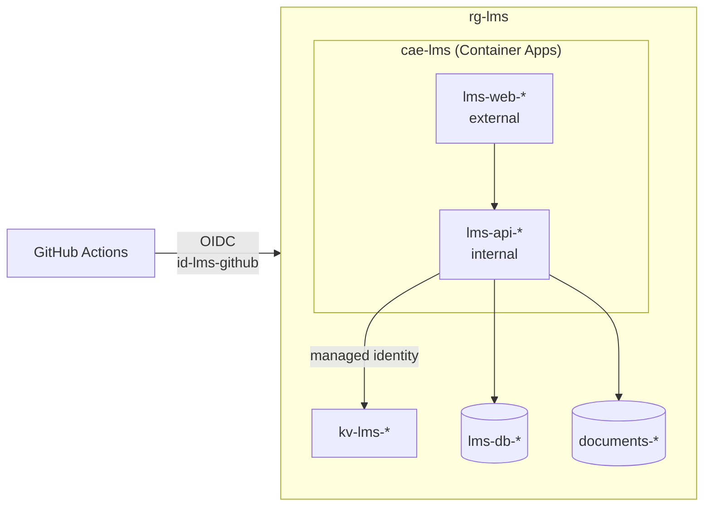

# Azure setup

Step-by-step setup of all Azure resources for the test and production environments: what to create, every setting to choose, and which roles to assign.

Do the steps in order. Steps marked **Owner** require the subscription owner, because only an Owner can assign roles. Everything else can be done with the Contributor role.

Names marked `<unique>` must be globally unique in Azure.

## Overview

## Resource list

| Resource | Name | Count |
|---|---|---|
| Resource group | `rg-lms` | 1 |
| SQL server | `sql-lms-<unique>` | 1 |
| SQL database | `lms-db-test`, `lms-db-prod` | 2 |
| Storage account | `stlms<unique>` | 1 |
| Blob container | `documents-test`, `documents-prod` | 2 |
| Key Vault | `kv-lms-test-<unique>`, `kv-lms-prod-<unique>` | 2 |
| Log Analytics workspace | `log-lms` | 1 |
| Container Apps environment | `cae-lms` | 1 |
| Container app | `lms-web-test`, `lms-api-test`, `lms-web-prod`, `lms-api-prod` | 4 |
| User-assigned managed identity | `id-lms-github` | 1 |

Use the same region for every resource, e.g. **Sweden Central**.

---

## Step 0 – Owner: prerequisites

The owner does these once.

### Budget alert

**Cost Management → Budgets → Add**

| Setting | Value |
|---|---|
| Scope | The subscription |
| Reset period | Monthly |
| Amount | The available credit |
| Alert conditions | Actual cost at 40 % and 80 % |
| Alert recipients | The owner's email |

### Access for the team

Either the owner does all role assignments in this guide (marked **Owner**), or the owner gives one team member permission to assign roles in the resource group:

**`rg-lms` → Access control (IAM) → Add role assignment** → `Role Based Access Control Administrator` → team member

With that role, the team member can do all **Owner** steps below except the budget alert.

---

## Step 1 – Resource group

Skip this step if the owner has already created it.

**Resource groups → Create**

| Setting | Value |
|---|---|
| Name | `rg-lms` |
| Region | Sweden Central |

---

## Step 2 – SQL server

**SQL servers → Create**

| Tab | Setting | Value |
|---|---|---|
| Basics | Resource group | `rg-lms` |
| | Server name | `sql-lms-<unique>` |
| | Location | Sweden Central |
| | Authentication method | Use SQL authentication |
| | Server admin login | `lmsadmin` |
| | Password | Strong generated password. Store it in a password manager. |
| Networking | Allow Azure services and resources to access this server | Yes |
| | Add current client IPv4 address | Optional. Only needed to connect from your own computer, e.g. with SSMS. |
| Security | Microsoft Defender for SQL | **Not now** (it costs extra) |

---

## Step 3 – SQL databases

**SQL databases → Create**. Repeat for `lms-db-test` and `lms-db-prod`.

| Tab | Setting | Value |
|---|---|---|
| Basics | Resource group | `rg-lms` |
| | Database name | `lms-db-test` / `lms-db-prod` |
| | Server | `sql-lms-<unique>` |
| | Want to use SQL elastic pool? | No |
| | Workload environment | Development |
| | Compute + storage | **Configure database** → *Looking for basic, standard, premium?* → **Basic** |
| | Backup storage redundancy | Locally-redundant backup storage |
| Additional settings | Use existing data | None |
| Security | Microsoft Defender for SQL | Not now |

Check that the cost summary shows the Basic price before you select **Create**.

---

## Step 4 – Storage account

**Storage accounts → Create**

| Tab | Setting | Value |
|---|---|---|
| Basics | Resource group | `rg-lms` |
| | Storage account name | `stlms<unique>` (lowercase letters and digits only) |
| | Region | Sweden Central |
| | Primary service | Azure Blob Storage or Azure Data Lake Storage Gen 2 |
| | Performance | Standard |
| | Redundancy | Locally-redundant storage (LRS) |
| Advanced | Require secure transfer | Enabled |
| | Allow enabling anonymous access on individual containers | Disabled |
| | Minimum TLS version | 1.2 |
| | Hierarchical namespace | Disabled |
| | Access tier | Hot |
| Networking | Network access | Enable public access from all networks |
| Data protection | Soft delete for blobs and containers | Enabled, 7 days |

**Blob containers:** storage account → **Data storage → Containers → + Container**

| Name | Anonymous access level |
|---|---|
| `documents-test` | Private |
| `documents-prod` | Private |

---

## Step 5 – Key Vaults

**Key vaults → Create**. Repeat for test and production.

| Tab | Setting | Value |
|---|---|---|
| Basics | Resource group | `rg-lms` |
| | Key vault name | `kv-lms-test-<unique>` / `kv-lms-prod-<unique>` |
| | Region | Sweden Central |
| | Pricing tier | Standard |
| | Days to retain deleted vaults | 7 |
| | Purge protection | Disabled |
| Access configuration | Permission model | Azure role-based access control |
| Networking | Enable public access | Yes, all networks |

### Owner: access to manage secrets

Nobody can create secrets until this role is assigned, not even the owner.

**Each Key Vault → Access control (IAM) → Add role assignment** → `Key Vault Secrets Officer` → the team members who manage secrets

### Secrets

**Each Key Vault → Objects → Secrets → Generate/Import**. Use the values for that vault's environment.

| Secret name | Value | Where to find it |
|---|---|---|
| `sql-connection-string` | Connection string to `lms-db-test` or `lms-db-prod` | SQL database → Settings → Connection strings → ADO.NET (SQL authentication). Replace `{your_password}`. |
| `jwt-secret-key` | Long random string, different in test and production | Generate one |
| `blob-connection-string` | Connection string to the storage account | Storage account → Security + networking → Access keys → Connection string |

---

## Step 6 – Container Apps environment

**Container Apps Environments → Create**

| Tab | Setting | Value |
|---|---|---|
| Basics | Resource group | `rg-lms` |
| | Environment name | `cae-lms` |
| | Region | Sweden Central |
| | Environment type | Consumption only. If only *Workload profiles* is offered, use it without adding any dedicated profiles. |
| | Zone redundancy | Disabled |
| Monitoring | Logs destination | Azure Log Analytics |
| | Log Analytics workspace | Create new: `log-lms` |
| Networking | Use your own virtual network | No |

---

## Step 7 – Container apps

**Container Apps → Create**. Repeat for all four apps.

| Tab | Setting | Value |
|---|---|---|
| Basics | Resource group | `rg-lms` |
| | Container app name | `lms-web-test` / `lms-api-test` / `lms-web-prod` / `lms-api-prod` |
| | Deployment source | Container image |
| | Container Apps environment | `cae-lms` |
| Container | Use quickstart image | Yes (replaced by the pipeline later) |
| Ingress | Ingress | Enabled |
| | Ingress traffic | `lms-web-*`: Accepting traffic from anywhere `lms-api-*`: Limited to Container Apps Environment |
| | Ingress type | HTTP |
| | Target port | 80 for the quickstart image. Change to **8080** when the real .NET image is deployed. |

After the app is created:

| Setting | Where | Value |
|---|---|---|
| CPU and memory | Application → Containers → Edit | 0.25 CPU, 0.5 Gi memory |
| Scale | Application → Scale | Min replicas 0, max replicas 1 |
| Identity | Settings → Identity → System assigned | On (API apps, and web apps if they need secrets) |
| Registry | Settings → Registries | Only if the GitHub packages are private: `ghcr.io`, GitHub username, personal access token with `read:packages` |

Internal ingress means the API can only be reached from inside the environment, so only the BFF can call it. Swagger is therefore only available locally.

### Owner: Key Vault access for the apps

Each app may only read its own environment's vault.

| Key Vault | Role | Assign to (managed identity) |
|---|---|---|
| `kv-lms-test-<unique>` | Key Vault Secrets User | `lms-api-test` |
| `kv-lms-prod-<unique>` | Key Vault Secrets User | `lms-api-prod` |

**Key Vault → Access control (IAM) → Add role assignment** → `Key Vault Secrets User` → *Assign access to: Managed identity* → *Container App* → the app

Repeat for the web apps if they need secrets.

### Secrets and environment variables

When the role is assigned, for each API app:

**Settings → Secrets → Add** → *Key Vault reference* → identity: *System assigned*

| Secret name in the app | Key Vault secret URL |
|---|---|
| `sql-connection-string` | `https://kv-lms-<env>-<unique>.vault.azure.net/secrets/sql-connection-string` |
| `jwt-secret-key` | `https://kv-lms-<env>-<unique>.vault.azure.net/secrets/jwt-secret-key` |
| `blob-connection-string` | `https://kv-lms-<env>-<unique>.vault.azure.net/secrets/blob-connection-string` |

**Application → Containers → Edit → Environment variables**

| Name | Source | Value |
|---|---|---|
| `ASPNETCORE_ENVIRONMENT` | Manual entry | `Staging` (test) / `Production` (prod) |
| `ConnectionStrings__ApplicationDbContext` | Reference a secret | `sql-connection-string` |
| `JwtSettings__SecretKey` | Reference a secret | `jwt-secret-key` |
| `BlobStorage__ConnectionString` | Reference a secret | `blob-connection-string` |

The variable names must match the configuration keys in the API's `appsettings.json`. `__` corresponds to `:`.

For each web app, add the API's internal URL as an environment variable. The URL is shown on the API app's **Overview** page under *Application Url*. The variable name depends on how the BFF configures YARP.

---

## Step 8 – Identity for GitHub Actions

**Managed Identities → Create**

| Setting | Value |
|---|---|
| Resource group | `rg-lms` |
| Region | Sweden Central |
| Name | `id-lms-github` |

**`id-lms-github` → Settings → Federated credentials → Add credential.** Repeat for `test` and `prod`.

| Setting | Value |
|---|---|
| Federated credential scenario | GitHub Actions deploying Azure resources |
| Organization | The GitHub account or organization that owns the repository |
| Repository | The repository name |
| Entity | Environment |
| Environment | `test` / `prod` |
| Name | `github-test` / `github-prod` |

### Owner: deploy permission

**`rg-lms` → Access control (IAM) → Add role assignment** → `Contributor` → *Managed identity* → `id-lms-github`

---

## Step 9 – GitHub

| Where | Setting | Value |
|---|---|---|
| Settings → General | Default branch | `Dev` |
| Settings → Branches | Branch protection for `master` and `Dev` | Require a pull request before merging, require status checks (CI) to pass |
| Settings → Environments | `test` | Deployment branches: `Dev` |
| | `prod` | Deployment branches: `master` |

**Settings → Secrets and variables → Actions → Secrets**

| Secret | Where to find the value |
|---|---|
| `AZURE_CLIENT_ID` | `id-lms-github` → Overview → Client ID |
| `AZURE_TENANT_ID` | Microsoft Entra ID → Overview → Tenant ID |
| `AZURE_SUBSCRIPTION_ID` | Subscriptions → Subscription ID |

**Settings → Secrets and variables → Actions → Variables**

| Variable | Value |
|---|---|
| `AZURE_RESOURCE_GROUP` | `rg-lms` |

---

## Role assignments

| Who | Role | Scope | Assigned by |
|---|---|---|---|
| Subscription owner | Owner | Subscription | – |
| Team members | Contributor | `rg-lms` or subscription | Owner |
| Optional: one team member | Role Based Access Control Administrator | `rg-lms` | Owner |
| Team members who manage secrets | Key Vault Secrets Officer | Both Key Vaults | Owner |
| `lms-api-test` (managed identity) | Key Vault Secrets User | `kv-lms-test-<unique>` | Owner |
| `lms-api-prod` (managed identity) | Key Vault Secrets User | `kv-lms-prod-<unique>` | Owner |
| `id-lms-github` | Contributor | `rg-lms` | Owner |

## Team access

1. **Microsoft Entra ID → Users → New user → Invite external user.** Enter the team member's email. They accept the invitation by email.
2. **`rg-lms` → Access control (IAM) → Add role assignment** → `Contributor` → the invited user.

Contributor can create, change and delete resources, view logs and restart apps. Contributor cannot assign roles or read Key Vault secrets.
