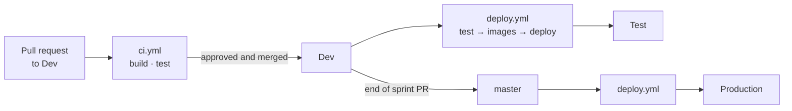

# Deployment

How code gets from a pull request to the test and production environments in Azure.
For setting up, moving or removing the Azure resources, see [Azure setup](azure-setup.md).

## Environments

| Environment | Deployed from | Web address | Purpose |
|---|---|---|---|
| Local | – | `https://localhost:7249` | Development on each team member's machine |
| Test | `Dev` | `https://lms-web-test.<domain>` | Verifying merged features in Azure |
| Production | `master` | `https://lms-web-prod.<domain>` | Sprint demos and final delivery |

`<domain>` is the default domain of the Container Apps environment `cae-lms`. The full address is shown by:

```powershell
az containerapp show --name lms-web-test --resource-group rg-lms --query properties.configuration.ingress.fqdn --output tsv
```

Test and production each have their own database, blob container, Key Vault and seed password. Nobody tests against the production database.

## Azure resources

| Part | Service |
|---|---|
| Blazor / BFF | Azure Container Apps, public (`lms-web-<env>`) |
| API | Azure Container Apps, internal: only reachable from the BFF (`lms-api-<env>`) |
| Images | Azure Container Registry, Basic |
| Database | Azure SQL Database, Basic (fixed price) |
| File storage | Azure Blob Storage, Standard, LRS, Hot |
| Secrets | Azure Key Vault, one per environment |

All resources are defined in Bicep files in `infra/`. See [Azure setup](azure-setup.md) for details.

## Pipelines



| Workflow | Runs on | Does |
|---|---|---|
| `ci.yml` | Every pull request to `Dev` and `master` | Restores, builds and tests the solution. The check **Build and test** is required before merging. |
| `deploy.yml` | Push to `Dev` (test) and `master` (prod), or **Run workflow** | Runs the same tests, builds container images with `dotnet publish`, pushes them to the registry and deploys them to the container apps |
| `infra.yml` | Push to `Dev` or `master` that changes `infra/`, or **Run workflow** | Deploys `infra/shared.bicep` and `infra/environment.bicep` |

`deploy.yml` and `infra.yml` never run at the same time for the same environment.

### Continuous integration

CI restores, builds and tests the solution on every pull request. A failed build or test is shown in the pull request and blocks the merge.

### Continuous deployment

- A merge into `Dev` deploys to the test environment.
- At the end of each sprint, `Dev` is merged into `master` through a pull request, which deploys to production.
- The tests run again before every deployment, since the merged code can differ from the pull request.
- Each image is tagged with the commit sha and the environment name (`test` or `prod`).

### Database

The API applies Entity Framework migrations when it starts, in every environment. A new migration is therefore deployed together with the code that needs it. No manual `Update-Database` is needed in Azure.

The seed data (roles, `admin@lms.com`, courses and students) is only created in an empty database. The seed password differs between environments and is stored as the GitHub secret `SEED_PASSWORD`.

## Logs

Azure portal → `lms-api-<env>` or `lms-web-<env>` → **Monitoring → Log stream**.
