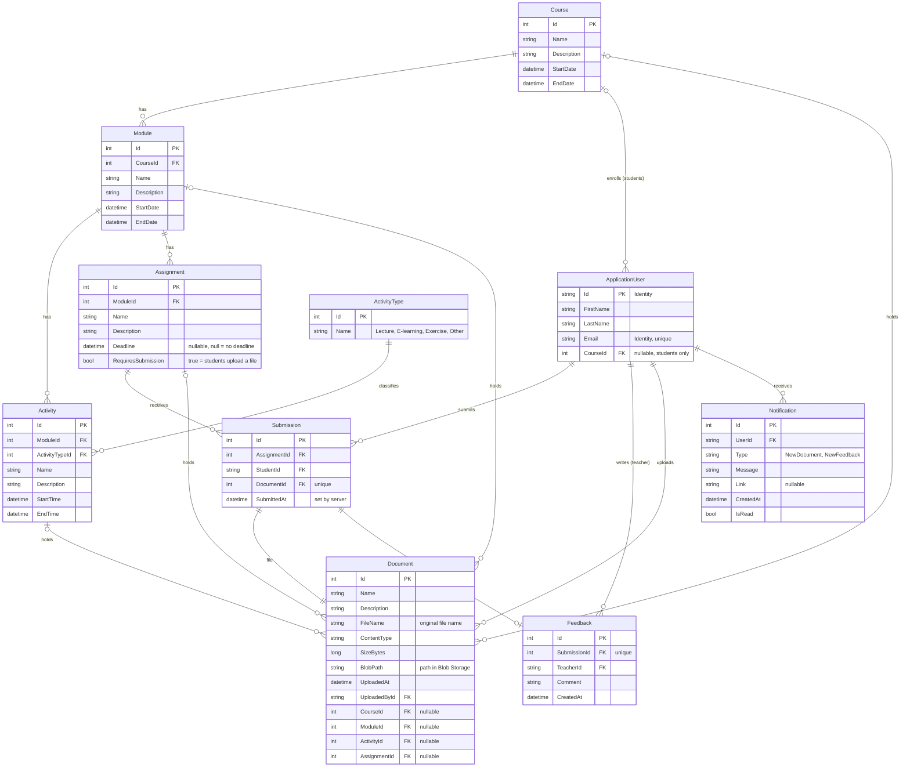

# ER diagram

> **Status:** Draft – pending team review and approval.
> Source file: [`er-diagram.mmd`](er-diagram.mmd)

**Notation:** `||` exactly one · `|o` zero or one · `o{` zero or more · `PK` primary key · `FK` foreign key

## Activities and assignments

An **activity** is a session in the module schedule (lecture, e-learning, exercise). It has a start and end time and takes up time in the schedule.

An **assignment** is a task for the students with an optional deadline. It is not shown as a block in the schedule, only by its deadline.

| Example | Modelled as | `Deadline` | `RequiresSubmission` |
|---|---|---|---|
| Lecture Monday 09:00–12:00 | Activity | – | – |
| Hand in a report by Friday 17:00 | Assignment | Friday 17:00 | `true` |
| Read a document by Friday 17:00 | Assignment | Friday 17:00 | `false` |
| Do an exercise before Friday 17:00 | Assignment | Friday 17:00 | `false` |
| Read a document, no deadline | Assignment | `null` | `false` |
| Practise when there is time | Assignment | `null` | `false` |

Submission status is calculated, not stored. For an assignment that requires submission, a student has **submitted** if a submission exists, **not submitted** if not and the deadline has not passed, and is **late** if not and the deadline has passed.

## Business rules

| Rule | Enforced in |
|---|---|
| Start date is before end date (course, module, activity) | DTO + service |
| A module is within the course period and does not overlap other modules in the course | `ModuleService` |
| An activity is within the module period and does not overlap other activities in the module | `ActivityService` |
| Assignments may overlap each other and activities; the deadline is optional | `AssignmentService` |
| Submissions are only accepted for assignments that require submission | `SubmissionService` |
| A student belongs to exactly one course | `UserService` |
| Access to course, document and submission data depends on role and course membership, even if an id or URL is manipulated | Services |
| File uploads validate file type and file size | `DocumentService` |

Invalid dates and overlaps are always rejected server-side, not only in the Blazor UI.
